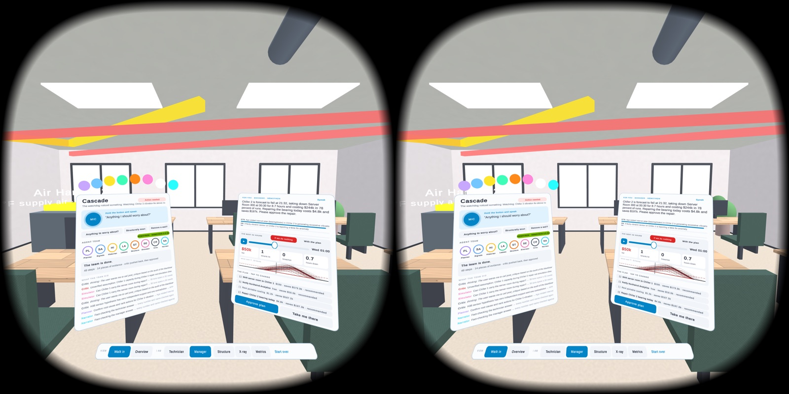
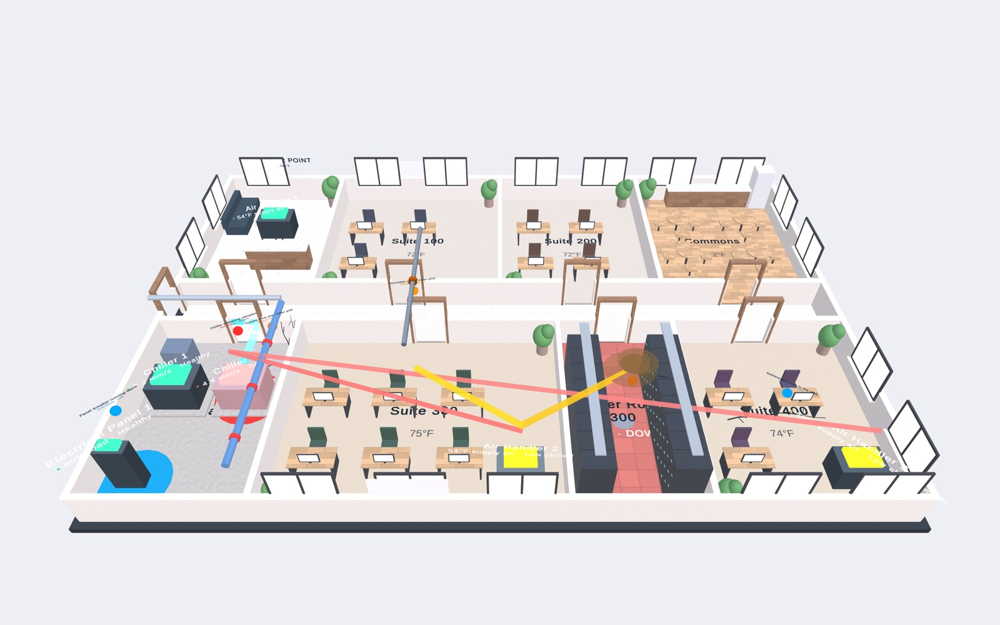
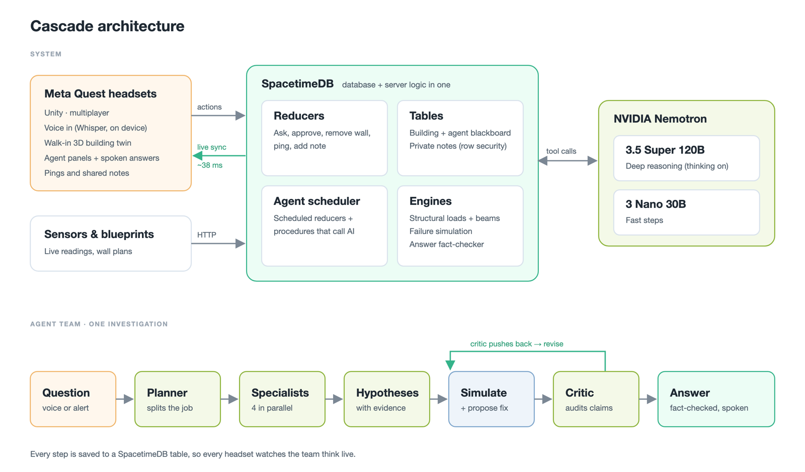

# ForeSite

**See the failure before it spreads.**

ForeSite is an AI-powered digital twin of a building that you can walk inside. Put on a Meta Quest 3S and you're standing in the building at full size. Eight NVIDIA Nemotron agents work alongside you: they predict cascading failures, price the damage, and carry out the fix before the disruption spreads.

Team:
Asritha Pinnamaneni,
Sanjana Vipperla,
Srihitha Peddibotla,
Pranavi Sammidi



---

## Why

Building failures are preventable. The warning signs are usually there, but they're scattered across floor plans, structural drawings, sensors, repair tickets and leases, each in a different system.

- **98 lives** were lost in the 2021 Surfside condo collapse. NIST found that cracks grew for about three weeks beforehand and the warning signs were ignored.
- **57%** of major outages cost more than $100,000, and 1 in 5 cost more than $1 million (Uptime Institute).
- **4 in 5** outages could have been prevented with better processes (Uptime Institute).
- **~30%** of the energy commercial buildings use is wasted (EPA).

ForeSite connects the dots before a small problem becomes a disaster.

## What it does

ForeSite rests on three pillars:

- 🔗 **One knowledge graph from fragmented data.** Agents can trace a load path the way an engineer reads a drawing set: *cooling tower → roof bay → east wall → footing*.
- 🧠 **Multi-agent reasoning grounded in real data.** It goes beyond a chatbot: every claim cites a database row, and all the math comes from an engineering engine.
- 👥 **Real-time collaboration.** A technician walks the building at full size while a manager watches a tabletop model, kept in sync in about 38 ms.

### From signal to verified fix

| | Step | What happens |
|---|---|---|
| 1 | **Connect** | Floor plans, structural drawings, sensors, tickets and leases are linked into one knowledge graph in a single transaction. |
| 2 | **Detect** | A 24/7 watchdog notices a drifting sensor and opens an investigation on its own, without anyone asking. |
| 3 | **Investigate** | Eight agents plan, gather evidence, form hypotheses and challenge each other. |
| 4 | **Predict the cascade** | The next 24 hours are simulated 50 ways. *Chiller 2 fails → the air handlers struggle → Server Room 300 overheats.* |
| 5 | **Price the impact** | Each outage is priced per tenant from real lease terms. One tenant's 99.7% uptime clause means a $50,000 penalty. |
| 6 | **Execute** | The manager approves with one tap. Work orders and the tenant notice are created in one transaction. |
| 7 | **Verify** | A follow-up simulation shows the fix worked: expected losses drop from **$244,000 to $4,800**. |

It also answers renovation questions. Ask *"Can we remove this wall?"* and you get a verdict, the steel beam you'd need, the cost and the schedule.



---

## Results

All numbers were measured on the live system.

| | |
|---|---|
| **15 / 15 vs 11 / 15** | Accuracy of Nemotron *with* ForeSite's tools vs the same model without them. |
| **4× faster** | Per question with tools (5.4 s median) vs without (~24 s). |
| **58 → 11** | Model calls per full investigation, with the specialists running in parallel. |
| **100%** | Spoken answers fact-checked against the data. |
| **8 / 8** | Load-bearing walls found. A floor-plan-only check finds 6 and misses the two that matter. |
| **~38 ms** | Median sync latency across headsets (p95 48 ms). |
| **~1,700 / s** | Full 24-hour cascade simulations per second, run inside the database. |

**Agents that correct themselves.** In one run, the Critic asked whether the backup chiller could carry the load during repairs. It approved the plan only after the simulation showed that it could.

---

## How it works



**🥽 Meta Quest 3 / 3S + Unity 6 (OpenXR).** You can walk through the building at full size, switch to a passthrough tabletop model, or use the X-ray and structure views. Every wall is generated live from database rows. You get around by pointing and pinching to glide, with no room-scale boundary.

**🎙️ Whisper, on the headset.** Hands-free voice input that works offline and keeps your words on the device.

**🧠 NVIDIA Nemotron agent team.** Eight agents (Planner, Signal Analyst, Maintenance Historian, Lease Analyst, Structural Engineer, Simulation Engineer, Critic and Narrator) run a fixed workflow:

```
Plan → Gather → Hypothesize → Simulate → Critique → Decide → Narrate
```

Nemotron 3.5 Super (120B, reasoning) plans, critiques and decides. Nemotron 3 Nano runs the four specialists in parallel. The agents call real tools against live data, such as `get_dependents`, `get_lease_terms`, the structural engine and the simulator. Every call is logged with its latency and token count.

**⚡ SpacetimeDB is the whole backend.** One module, with no separate server, holds:

- the knowledge graph,
- the structural engine,
- the failure simulator,
- the agent runtime,
- an HTTP API,
- multiplayer sync.

The database calls Nemotron itself through `ctx.http.fetch`. The module uses:

- ACID reducers;
- scheduled reducers for the watchdog, agent phases and evals;
- HTTP routes (`/blueprint`, `/sensor`, `/metrics`);
- event tables for live pings;
- row-level security for private notes and the API key.

**✅ Grounded AI.** Every claim must cite a real database row, the engineering engine does all the math, and every spoken number is fact-checked. The model reasons; the database verifies.

---

## Repository layout

```
Assets/Cascade/          Unity client: twin renderer, agent panels, navigation, voice
  Scripts/               App, views, zoom navigation, panel raycasting
  Generated/             SpacetimeDB client bindings (generated)
  Editor/                Build steps (e.g. boundaryless Quest manifest)
Server/cascade/          SpacetimeDB module (TypeScript): graph, engines, agents, HTTP API
Server/bench/            Latency and accuracy benchmarks
Tools/                   Helper scripts (Whisper model download)
docs/                    Feature notes and images
```

*"Cascade" is the project's internal codename, so you'll see it in code and namespaces.*

## Run it yourself

**Requirements:**

- Unity 6 with Android build support
- A Meta Quest 3 or 3S in developer mode
- The [SpacetimeDB CLI](https://spacetimedb.com/install)
- Node.js
- An NVIDIA API key

**1. Publish the backend.**

```sh
cd Server/cascade
npm install
spacetime publish <your-db-name> --module-path . --server maincloud
```

**2. Add your NVIDIA key.** It goes into a private table that clients can never read. Only the database owner can set it.

```sh
spacetime call <your-db-name> set_nvidia_key '"nvapi-..."' --server maincloud
```

**3. Get the on-device speech model.** It is about 148 MB, which is too large to commit.

```sh
./Tools/fetch-whisper-model.sh
```

**4. Build to the headset.** Open the project in Unity, point the client at your database name, switch the platform to Android, then use **Build And Run** with the Quest connected.

---

## What we learned

- **Fragmented data is the real problem.** The warning signs usually exist; they just aren't connected.
- **Tools beat raw model power.** Grounded agents were both more accurate and faster.
- **Putting the logic inside the database** removed whole classes of sync and latency bugs.
- **Keep humans in the loop.** The AI runs the investigation, and people make the call.

## What's next

- Pilots in hospitals, data centers and schools.
- Long-term tracking of cracks and water damage.
- BIM/Revit import, plus work-order integration with ServiceNow and Maximo.

---

<p align="center"><b>ForeSite</b>: from fragmented data to a verified fix, end to end.</p>
